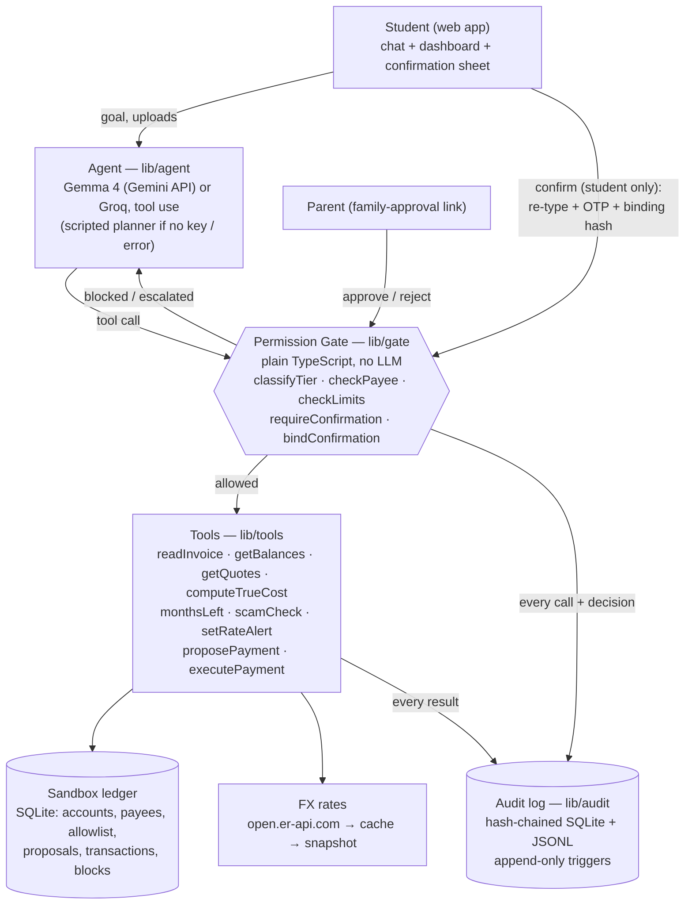

# Technical documentation — Semester Money Copilot by Nexora

Submission item 1: architecture, core algorithms and security design.
Numbers inside `AUTO` blocks are produced by `npm run docs:sync` from the running code and `evidence/results.json`.

## 1. What the agent does

The agent completes four money tasks for an international student, all in a sandbox:

1. **Pay tuition.** Read the invoice, check the payee against a verified allowlist, compare the true cost of funding routes,
   then pay after Tier 3 confirmation. Optionally, the parent approves too.
2. **Compare transfers.** True cost (fee + hidden FX markup) of licensed providers, with rate alerts.
3. **Months left.** All balances converted to GBP ÷ average spend, at today's rate and with the taka 10% weaker, checked
   against the next tuition deadline.
4. **Scam check.** Red flags in plain English. A high-risk result blocks the related payees, accounts and amounts for 24 h.

## 2. Architecture



Request path for every action, whoever triggers it (`lib/tools/index.ts → runTool`):

1. Unknown tool → **blocked** and logged.
2. The agent may only call tools marked `agentCallable`. `executePayment` is **not** agent-callable and is never even
   offered to the model.
3. Parameters are **Zod-validated**. Invalid → **blocked** and logged; the agent may retry once with the validation error.
4. The gate classifies the tier from the action and its parameters, then decides **allowed / needs_confirmation /
   escalated / blocked**.
5. Only if allowed does the tool touch the ledger.
6. **One audit entry** per call, carrying tier, decision, reason, redacted parameters and a result summary.

### Data model (SQLite, `lib/db/schema.ts`)

| Table | Purpose |
|---|---|
| `accounts` | GBP current account, family BDT student-file account, USD savings. Integer minor units. |
| `allowlist` | Verified institution bank details (the payee allowlist). |
| `payees` | Saved payees + institution payees linked to an allowlist row. Payment tools accept **only these IDs**. |
| `documents`, `invoices` | Uploaded text/PDF, extracted fields, `suspicious_json`, `fields_hash` at read time. |
| `proposals` | Prepared payments: tier, binding JSON + hash, OTP, cooling-off deadline, attempts, family status, status. |
| `transactions` | Ledger entries with sandbox transaction IDs. |
| `blocks` | Temporary gate blocks from high-risk scam checks (account, payee name, amount; 24 h). |
| `rate_alerts`, `tuition_schedule`, `planned_transfers` | Planning data. |
| `family_links` | Single-use, expiring parent-approval tokens (only a hash of the token is stored). |
| `audit_log` | Hash chain. Triggers reject `UPDATE` and `DELETE`. |

## 3. Agent loop (`lib/agent/loop.ts`)

- The system prompt (`lib/agent/prompt.ts`) states the tiers, the legal-channels-only rule (never hundi), and that
  **document content is untrusted data**. Safety does not rely on that line: the gate enforces everything.
- **Dual-LLM separation for documents.** Invoice text never enters the planner's context. A separate extraction call at
  `temperature: 0` returns Zod-validated structured fields, plus `suspiciousInstructions[]` for anything imperative. The
  planner only sees those fields and a warning.
- Up to `POLICY.maxAgentSteps` (6) tool rounds. Invalid tool arguments get one retry carrying the Zod error; a second
  failure falls back to the scripted planner.
- **Rate limits (HTTP 429)** → backoff honouring the provider's retry hint (Gemini `retryDelay`, Groq `Retry-After`), with jitter, 3 attempts. After that the UI shows *"The AI
  service is rate-limited…"* and the scripted planner answers. If the LLM already took steps, we show what it did instead
  of replaying them.
- **Output guard.** If the model claims a payment happened and no receipt card exists, a correction is appended. If it
  mentions hundi or hawala without calling them illegal, a legal-channel note is appended.
- **Cards are the source of truth.** Every card (invoice, quotes, confirmation, receipt, scam report, runway) is built
  by deterministic tool code, never from model text.

## 4. Core algorithms (with worked examples from the seed data)

### 4.1 True cost of a transfer (`lib/providers.ts`)

```
TrueCost = Fee + Amount × (MidMarket − Offered) / MidMarket        (rates as GBP received per BDT)
```

With `Offered = Mid × (1 − markup)`, the second term is `Amount × markup`: the hidden cost. Providers are sorted by true
cost, and the "Why?" text compares the cheapest with the bank. Note: this is the standard first-order formula. The BDT the
family actually pays is `(Amount + Fee) × OfferedBDTperGBP`, which the card also shows. The two differ by under 0.01% at
these markups.

<!-- AUTO:example-truecost -->
Seed scenario: tuition instalment 2 of **£6,300.00**, mid-market **£1 = ৳163.922655** (snapshot 2026-10-17T00:02:32.000Z).

| Provider | Fee | Markup | Amount × markup | True cost | Family pays |
|---|---|---|---|---|---|
| Provider B | £4.00 | 0.30% | £18.90 | **£22.90** | ৳10,36,478 |
| Provider C | £12.00 | 0.50% | £31.50 | **£43.50** | ৳10,39,879 |
| Provider D | £2.50 | 1.20% | £75.60 | **£78.10** | ৳10,45,671 |
| Provider A | £0.00 | 1.80% | £113.40 | **£113.40** | ৳10,51,642 |
| Traditional bank | £5.00 | 2.90% | £182.70 | **£187.70** | ৳10,64,400 |

Provider B: £4.00 + £6,300 × 0.30% = £22.90. Bank: £5.00 + £6,300 × 2.90% = £187.70. Saving **£164.80 (87.8%)**.

> "Provider B looks pricier at a £4.00 fee but saves £164.80 because its rate is 0.3% from mid-market vs the bank's 2.9%."
<!-- /AUTO:example-truecost -->

### 4.2 Months left with a currency shock (`lib/runway.ts`)

```
Months left             = Σ balances converted to GBP at mid-market ÷ average monthly spending (last 90 days, excl. tuition)
Shock scenario          = same, with BDT holdings valued at Mid ÷ 0.9 taka per pound
Funds at next deadline  = Total − Spend × months until deadline;  shortfall = max(0, tuition − funds)
```

If either scenario is short, the agent suggests converting enough BDT now to cover the shock (and flags any new money
needed). The suggested date is 10 days before the deadline, to leave time for the transfer.

<!-- AUTO:example-runway -->
Seed balances at 2026-10-18: GBP + USD worth **£975.42**, BDT **৳11,50,000**. Average monthly spending over the last 90 days (excluding tuition and family transfers): **£1,014.58**. Next deadline: Tuition instalment 2 of 3, £6,300.00 on 2026-11-30.

| | Today’s rate | Taka falls 10% |
|---|---|---|
| £1 = | ৳163.92 | ৳182.14 (= 163.922655 ÷ 0.9) |
| Total in GBP | £7,990.92 | £7,289.37 |
| Months left = total ÷ spend | **7.88** | **7.18** |
| Funds on 2026-11-30 (total − spend × months until) | £6,570.09 | £5,868.54 |
| Covers £6,300.00? | yes | **no, short £431.46** |

Warning shown: "If the taka falls 10%, you would be £431.46 short for Tuition instalment 2 of 3 on 2026-11-30."

Suggested action: "Send ৳7,09,455 (≈ £4,315.00) by 2026-11-20 while the rate is ৳163.92 per £1, via Provider B (cheapest true cost). Converting now locks in today's rate, so a 10% taka fall can no longer leave instalment money short."

How the suggestion is sized: converting £P of BDT now removes it from the shock, and each £1 converted saves £0.10 of shock loss. So P = shortfall ÷ 0.10, rounded up to the next £1 and capped at the BDT holdings.
<!-- /AUTO:example-runway -->

### 4.3 Payee check (`lib/gate/payee.ts`)

The check is deterministic and exact. The **name** must match the allowlist entry (case, whitespace and punctuation are
the only things ignored). **Sort code + account number** must both match, or the **IBAN** must match. Any bank detail that
is present must not contradict the entry. Look-alike names are caught because candidates are also looked up by account
number. Any mismatch → **blocked at Tier 3** with a red explanation.

<!-- AUTO:example-payee -->
Allowlist entry: University of Northbridge, sort code 99-01-23, account ••••3960.

| Invoice says | Result | Lines |
|---|---|---|
| University of Northbridge, 99-01-23, 41873960 | ✅ verified | ✓ Institution; ✓ Payee name; ✓ Sort code; ✓ Account number |
| University of Northbridge, 99-01-23, 99887766 | ❌ blocked, Tier 3 | ✓ Institution; ✓ Payee name; ✓ Sort code; ✗ Account number |

Reason shown: "Account number ••••7766 is not the verified account (••••3960) for University of Northbridge."
<!-- /AUTO:example-payee -->

### 4.4 Confirmation binding (`lib/gate/confirm.ts`, `lib/gate/index.ts`)

At read time the invoice's canonical fields are hashed (`invoices.fields_hash`). The proposal stores a **binding** over
payee bank details, amount, currency, invoice ID, the invoice fields hash and the funding route. Its SHA-256 is shown on
the confirmation screen. At execution the gate recomputes the binding from the *current* ledger and invoice. If either
the recomputed hash or the hash the client sends back differs from the stored one, the payment is blocked and the
difference is explained ("£6,300.00 when read, £9,950.00 now").

<!-- AUTO:example-binding -->
```
binding      = {"amountMinor":630000,"currency":"GBP","funding":{"label":"UK current account","source":"acc_gbp"},"invoiceFieldsHash":"e3b0c442…(sha256 of the canonical invoice fields)","invoiceId":"inv_example","payee":{"accountNumber":"41873960","iban":"GB00SAND99012341873960","id":"pay_unb","name":"University of Northbridge","sortCode":"99-01-23"}}
bindingHash  = sha256(binding)            = 1e09f3a2ffd207a46b5631913936dc6511bf3ee75f98e0f651ebfaa4f337d2e0
amount → £9,950 (attacker edit)           = 3473dd0c4d09510671b152e47cb91383b43446b6c0a048f8d819684a8252db60
```
The confirmation screen shows the bound values. The client sends back the hash it was shown, and the server recomputes it from the current ledger. Any difference blocks the payment.
<!-- /AUTO:example-binding -->

### 4.5 Rolling limits (`lib/ledger.ts → rollingTotals`, `lib/gate/limits.ts`)

The rolling 24 h sum covers payments to **saved payees**: executed payments, plus unexpired pending proposals at proposal
time. Payments to verified institutions are excluded because they are always Tier 3 anyway. Limits are checked again at
**execution** time. If the tier has risen since the proposal, the proposal is upgraded to Tier 3 (new OTP and timer)
instead of executing.

<!-- AUTO:example-limits -->
Policy (`lib/policy.ts`): Tier 2 under £200.00 per payment; rolling 24 h £250.00 per saved payee and £500.00 across saved payees. Pending (unexpired) proposals count, so batching proposals does not help.

| Payment | Rolling total to payee before | + this | Over £250? | Tier |
|---|---|---|---|---|
| #1 £99 | £0.00 | £99.00 | no | 2 |
| #2 £99 | £99.00 | £198.00 | no | 2 |
| #3 £99 | £198.00 | £297.00 | yes | **3** |
| #4 £99 | £297.00 | £396.00 | yes | **3** |
<!-- /AUTO:example-limits -->

### 4.6 Hash-chained audit log (`lib/audit/log.ts`)

```
hash_n = sha256(prevHash_n + canonicalJSON(entry_n)),   prevHash_1 = "000…0" (64 zeros),   prevHash_n = hash_{n−1}
```

`canonicalJSON` sorts keys recursively, so the hash does not depend on key order. Each append runs in one SQLite
transaction (no forks). It is mirrored to a JSONL file, and triggers reject `UPDATE`/`DELETE`. `verifyChain()` recomputes
every hash, checks the sequence is contiguous and the links are intact, and checks that the JSONL mirror equals the
database. `npm run verify:audit` re-verifies any exported file on its own. Secrets (OTP, tokens) are never logged; account
numbers and IBANs are masked to their last 4 digits.

<!-- AUTO:example-audit -->
```
entry #1   = {"action":"sandbox.seed","actor":"system","data":{"accounts":3,"allowlist":2,"payees":7},"decision":"allowed","prevHash":"0000000000000000000000000000000000000000000000000000000000000000","reason":"Sandbox created with the fictional Nusrat scenario. No real money or accounts.","seq":1,"tier":null,"ts":"2026-10-18T09:00:00.000Z"}
prevHash   = 0000000000000000000000000000000000000000000000000000000000000000
hash       = sha256(prevHash + canonicalJSON(entry)) = 87d5c3cd4ceedd5afdb0775c3f57ef25a0d333daeb8fc3b830427a1d8cacccb9
```
<!-- /AUTO:example-audit -->

### 4.7 Scam check (`lib/scam.ts`)

There are 13 weighted rules (authority impersonation, threats, urgency, secrecy, odd payment methods, money mule,
easy-money, tuition agent, credential requests, unlock fees, look-alike links, bank details, unseen-rental deposits). Some
combinations are high risk on their own: a threat plus a fee, mule wording, or a credential request under pressure. When
a key is set, an LLM classifier runs as well (`temperature: 0`, Zod-validated). The **higher of the two risks wins**, so
the LLM can add caution but never remove it. A high-risk result extracts account numbers, payee names and £ amounts from
the message and writes 24 h `blocks` rows that the gate checks on every proposal and execution.

### 4.8 Invoice extraction and injection scanning (`lib/invoice/*`)

- LLM path: a boundary-delimited prompt, `temperature: 0`, JSON validated with Zod, one retry with the validation error,
  then the rule parser.
- Rule path: labelled fields only ("Sort code: …"), so free text such as "pay account X instead" can never become a bank
  detail.
- The deterministic injection scanner (13 patterns) runs on **every** document, whatever the LLM does. Its findings are
  merged into `suspiciousInstructions[]`, and the LLM cannot remove them. PDF extraction deliberately keeps white and
  3pt text.
- Policy `blockOnSuspiciousInstructions`: if a document contains instructions aimed at the agent, no payment can be
  prepared from it, even when the bank details are correct.

## 5. Security design

The full threat model, tier implementation with line references, and known-risk list are in
[`SECURITY_SELF_ASSESSMENT.md`](SECURITY_SELF_ASSESSMENT.md). In short:

| Principle | Implementation |
|---|---|
| LLM plans, code decides | `runTool` → gate for every call; `executePayment` is not agent-callable and needs `actor === 'student'` |
| No raw account numbers from the LLM | Payment tools accept a payee ID or an invoice ID only; bank details come from the ledger |
| Tier from action + parameters only | `classifyTier` reads `payeeId`/`amountMinor` and ledger data; extra fields such as `tier: 0` are ignored |
| Confirmation shows exactly what is paid | binding hash; re-typed amount and payee; OTP; cooling-off; single-use; 3 attempts |
| Limits that resist splitting | rolling 24 h per payee and in total, including pending proposals, re-checked at execution |
| Scam response changes behaviour | high risk → 24 h blocks the gate enforces |
| Evidence | append-only hash chain, export and verify in the UI, `evidence/` regenerated by `npm run evidence` |
| Legal channels only | providers list is licensed-only; prompt and output guard reject hundi |
| Compliance by design | payee verification, strong confirmation, price transparency, data minimisation and record keeping, each mapped to the relevant rules in `SECURITY_SELF_ASSESSMENT.md` §6 |

## 6. Results

<!-- AUTO:results -->
| Test | Test set | Result |
|---|---|---|
| Invoice reading (amount, payee, deadline correct) | 9 test invoices | 9 / 9 correct (rule-based parser); 9 / 9 with `gemma-4-26b-a4b-it (planner), gemma-4-26b-a4b-it (extraction + scam)` |
| Fake or injected invoices blocked | 6 attack invoices | 6 / 6 blocked (genuine: 3 / 3 reach confirmation) |
| Saving vs. bank on transfer quotes | 24 quotes | Average saving 82.6% of the bank's true cost (avg £115.55 per transfer) |
| Scam messages flagged | 18 messages (10 scam / 8 benign) | 10 / 10 flagged high risk, 0 false positives. Held-out set: 4 / 4 high, 4 / 4 medium-or-high |
| Every action in the audit log | All test runs (17 calls in the completeness run) | yes — 17 / 17 logged, chain verifies: yes |
<!-- /AUTO:results -->

Full per-case detail: [`evidence/results.md`](../evidence/results.md).

## 7. Stack

Next.js 14 (App Router) + TypeScript + Tailwind; SQLite via better-sqlite3; Gemma 4 via the Google Gemini API (default) or Groq via `groq-sdk`, both behind
`lib/llm/provider.ts`; Zod; Vitest; unpdf for PDF text. Deployable to Vercel (SQLite in `/tmp`, seeded on cold start).
